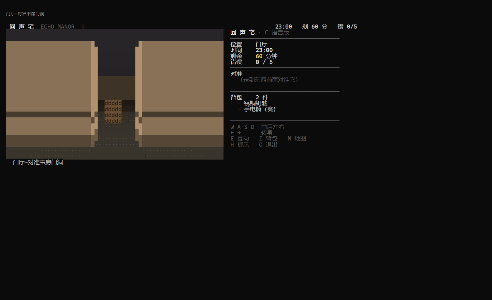

# 回声宅 · Echo Manor（C 语言版）

一款用 **C17** 写的命令行密室逃脱游戏。推开门，你只有 60 分钟，在三个房间里找出六道谜题的答案——房子会记得你来过几次。

单文件、零第三方库，只用 `windows.h` + `conio.h`。



## 项目概况

| 项目 | 说明 |
| --- | --- |
| 语言 | C（C17），MSVC 编译，`/W4` 零警告 |
| 代码规模 | 2041 行（画面版）+ 864 行（菜单版），两个独立单文件程序 |
| 第三方依赖 | 无。仅 Windows 控制台 API（`_getch`、`SetConsoleOutputCP`、`Beep`） |
| 运行平台 | Windows 10 / 11 的命令行窗口 |
| 玩法 | 3 个房间、6 道互相咬合的谜题、3 种结局、60 分钟限时、错 5 次判负 |
| 图形 | 无图形库，用**光线投射**把房间画成字符画面 |

## 两个版本

| 版本 | 源码 | 行数 | 玩法 |
| --- | --- | --- | --- |
| 第一人称画面版 | `echo_house_fp.c` | 2041 | 光线投射画出墙、地、天花板与家具，`WASD` 走动、`← →` 转身、`E` 互动 |
| 菜单文字版 | `echo_house_c.c` | 864 | 一屏文字 + 编号菜单（1 查看 / 2 使用 / 3 离开），最适合当教材读 |

两个版本各自带 `main()`，**必须分开编译**，放进同一个工程会报重复定义。

## 编译（MSVC，C17）

```bat
:: 第一人称画面版
cl /nologo /std:c17 /W4 /utf-8 /Fe:echo_house_fp.exe echo_house_fp.c

:: 菜单文字版
cl /nologo /std:c17 /W4 /utf-8 /Fe:echo_house_c.exe  echo_house_c.c
```

## 运行

```bat
:: 在源码所在目录打开命令行（cmd / PowerShell / Windows Terminal 均可）
echo_house_fp.exe              :: 画面版：直接玩
echo_house_c.exe               :: 菜单版：直接玩

:: 画面版自带的三套自检，改完代码不用手点
echo_house_fp.exe --walktest   :: 真的按 W / ← → / E 走位通关，39 项检查
echo_house_fp.exe --autotest   :: 直接调动作函数通关，16 项检查
echo_house_fp.exe --dump       :: 导出 9 个机位，逐行校验显示宽度
```

不想编译也可以：下载 `echo-manor-c-fp-windows.zip`（184 KB），解压双击 `回声宅C画面版.exe` 即可。

## 环境要求

- **Windows 10 / 11**：用到 `_getch()`、`SetConsoleOutputCP(65001)` 等控制台 API
- **MSVC**：VS 2019 / 2022 的「x64 本机工具命令提示符」，或任意支持 C17 的编译器
- 源码为 **UTF-8 带 BOM**：否则中文 Windows 下 `cl` 会按 GBK 读文件，中文注释和方块字符会乱码
- 运行时输出走 UTF-8（`/utf-8` 编译 + `SetConsoleOutputCP`），字体建议「新宋体」或「等距更纱黑体」，方块才对得齐

## 画面版操作

| 按键 | 作用 |
| --- | --- |
| `W` `A` `S` `D` | 前后左右走（贴墙自动滑开） |
| `←` `→` | 转身 |
| `E` | 与准星指向的物件互动 |
| `I` | 背包 |
| `M` | 地图 |
| `H` | 提示（会扣时间和错误次数） |
| `Q` | 退出当前面板 |

## 玩什么

三个房间——门厅、书房、地下室——六道互相咬合的谜题：

1. **五色书**：按日记里的"排书法"把五本书排成正确顺序，暗格弹出小铜钥匙
2. **座钟**：指针停在 3:12，钟面背后藏着齿轮
3. **八音盒**：听四个音（用 `Beep()` 真的响），复奏出来得到密码
4. **保险箱**：1986，来自祖父的日记
5. **上锁木箱**：0417，来自账本上的日期
6. **配电箱**：按照明线路顺序推上三把闸刀，整座房子通电

找齐手电、电池、保险丝，才能下到地下室。错 5 次或超时 60 分钟，房子会留下你。

<details>
<summary>完整通关顺序（剧透，点开看）</summary>

1. 书房写字台 → 手电筒；门厅鞋柜 → 电池；按 `I` 把电池装进手电筒
2. 五色书按 红→黄→蓝→绿→紫 排列 → 小铜钥匙
3. 座钟背板 → 齿轮（挂钟指针停在 3:12）
4. 八音盒装齿轮 → 听 4 个音 → 复奏（旋律即 5263）
5. 书房保险箱 → `1986` → 铜钥匙
6. 地下室储物柜 → 保险丝 → 装进配电箱 → 闸刀 3-1-2 → 通电
7. 地下室木箱 → `0417` → 怀表
8. 大门数字锁 → `5263` → 离开

</details>

## 自检结果（2026-11-26 实跑）

| 项目 | 结果 |
| --- | --- |
| 编译（`/W4`） | 零警告 |
| `--walktest` | 39 项全部通过：通关 18 分钟、0 错误、结局「走出去的人」；另含两个失败结局分支 |
| `--autotest` | 16 项全部通过：16 分钟、0 错误 |
| `--dump` | 9 个机位，每行恰好 105 列，中文与字符块无错位 |
| 隔墙互动扫描 | 49680 个机位，0 次能隔着墙按 E |
| 随机碰撞测试 | 随机按 800 次键，0 次踩进墙里 |

## 仓库文件

| 文件 | 说明 |
| --- | --- |
| `echo_house_fp.c` | 第一人称画面版源码（2041 行） |
| `echo_house_c.c` | 菜单文字版源码（864 行） |
| `C-FP-VERSION.md` | 画面版的玩法、画面原理、编译方式、代码结构与自检说明 |
| `C-VERSION.md` | 菜单文字版的玩法、编译方式与代码结构说明 |
| `echo-manor-c-fp-windows.zip` | Windows 成品包（exe + 源码 + 截图），解压即玩 |
| `screenshot-c.png` | 画面版实际运行截图 |

## 画面是怎么画出来的

没有图形库，所以每一帧都是自己算的：

1. **每列一条射线**：屏幕 64 列，每列从玩家位置发一条射线，用 DDA 走到撞墙为止，得到"到墙的距离"。
2. **按距离定高**：`高度 = 常数 / 距离`，近处的墙占满屏幕，远处的墙缩成一条。天花板和地面同理，按行反算距离。
3. **按距离定亮**：`亮度 = 1.30 - 距离 × 0.085`，越远越暗，房间就有了纵深。
4. **家具是广告牌**：书架、保险箱、大门不参与射线，而是投影成一块竖条，再用"每列墙的距离"做深度测试——所以站在墙角时家具会被墙切掉一半，这是正确的。
5. **逐格着色**：每个字符格存一个 UTF-8 字符 + 真彩色前景/背景，一帧拼成 24 行 × 105 列，一次性输出。

## 许可

代码可自由学习、修改、二次分发。游戏文本与美术均为程序化生成，不含第三方素材。
