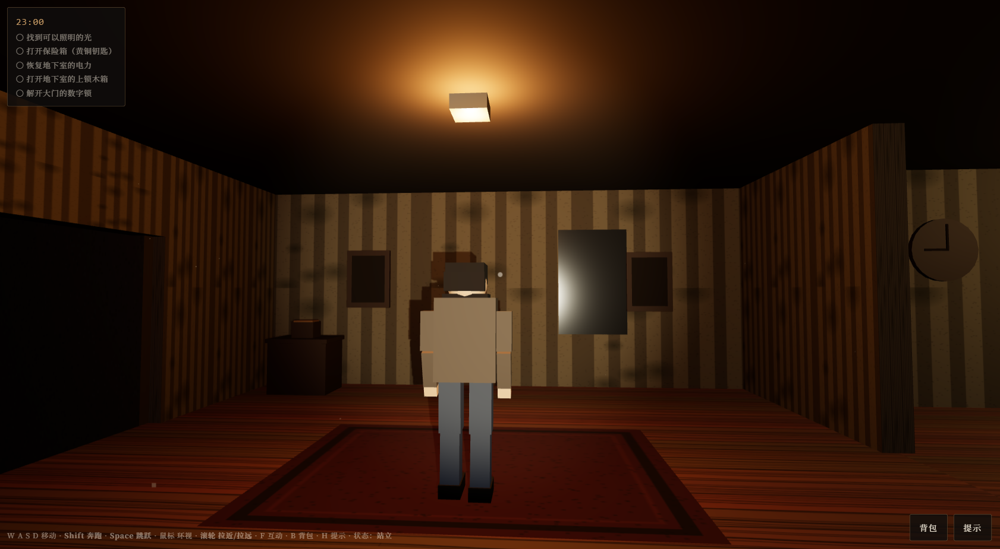

# 回声宅 · Echo Manor

一款**单文件、零依赖、可离线运行**的 3D 密室逃脱小游戏。推开门，你只有 60 分钟，在三个房间里找出六道谜题的答案——房子会记得你来过几次。



- **在线试玩**：<https://zhaoyuhao2007.github.io/echo-manor/>
- **本地游玩**：下载 `index.html`，双击用浏览器打开。不需要服务器、不需要联网（Three.js r160 已内联进文件）
- **体积**：760 KB 单文件，含 3D 引擎、程序化贴图与音效
- **技术栈**：Three.js + 原生 JavaScript，无框架、无构建步骤
- **C 语言版**：另有两个终端版本 —— 菜单文字版（`echo_house_c.c`）与第一人称画面版（`echo_house_fp.c`），谜题与网页版一致

---

## 操作

| 按键 | 作用 |
| --- | --- |
| `W` `A` `S` `D` | 移动（相对相机方向） |
| `Shift` | 奔跑（速度 2.5 → 4.5 m/s，步频与摆臂同步加快） |
| `Space` | 跳跃（初速 4.6、重力 14，跳高 0.71 m） |
| 鼠标 | 环视，点击画面锁定指针，`Esc` 释放 |
| 滚轮 | 拉近 / 拉远镜头（1.25 m ~ 5.8 m） |
| `F` | 与准星指向的物件互动 |
| `B` | 背包 |
| `H` | 提示（会扣时间和错误次数） |

触屏设备会显示虚拟摇杆：推满摇杆自动奔跑，右下角有跳跃与互动按钮。

## 玩什么

三个房间——门厅、书房、地下室——六道互相咬合的谜题：

1. **五色书**：按日记里的"排书法"把五本书排成正确顺序，暗格弹出小铜钥匙
2. **座钟**：指针停在 3:12，钟面背后藏着齿轮
3. **八音盒**：听四个音，复奏出来，得到密码
4. **保险箱**：1986，来自祖父的日记
5. **上锁木箱**：0417，来自账本上的日期
6. **配电箱**：按照明线路顺序推上三把闸刀，整座房子通电

找齐手电、电池、保险丝，才能下到地下室。错 5 次或超时 60 分钟，房子会留下你。

<details>
<summary>完整通关顺序（剧透，点开看）</summary>

1. 书房写字台 → 手电筒；门厅鞋柜 → 电池；按 `I` 把电池装进手电筒
2. 五色书按 红→黄→蓝→绿→紫 排列 → 小铜钥匙
3. 座钟背板 → 齿轮（挂钟指针停在 3:12）
4. 八音盒装齿轮 → 听 4 个音 → 复奏（旋律即 5263）
5. 书房保险箱 → `1986` → 铜钥匙
6. 地下室储物柜 → 保险丝 → 装进配电箱 → 闸刀 3-1-2 → 通电
7. 地下室木箱 → `0417` → 怀表
8. 大门数字锁 → `5263` → 离开

</details>

## 仓库内容

| 文件 | 说明 |
| --- | --- |
| `index.html` | **3D 网页版**，单文件游戏本体（Three.js 内联，可直接部署到任何静态托管） |
| `echo_house_fp.c` | **C 语言版 · 第一人称画面版**（约 2000 行）：命令行里用光线投射画出墙、地、天花板和家具，`WASD` 走动、`E` 互动。单文件、无第三方库 |
| `C-FP-VERSION.md` | 画面版的玩法、画面原理、编译方式、代码结构与自检说明 |
| `echo-manor-c-fp-windows.zip` | 画面版的 Windows 成品包（exe + 源码 + 截图），解压即玩 |
| `screenshot-c.png` | 画面版的实际运行截图 |
| `echo_house_c.c` | **C 语言版 · 菜单文字版**，864 行单文件、仅依赖 Windows 控制台 API，谜题与网页版一一对应 |
| `C-VERSION.md` | 菜单文字版的玩法、编译方式与代码结构说明 |
| `desktop-shell.cpp` | **Windows 桌面外壳**（190 行 C++ / Win32 + WebView2），把网页版装进独立窗口 |
| `DESKTOP.txt` | 桌面版打包与使用说明 |
| `GUIDE-01-overview.md` | 源码导读：两层结构、启动链路、主循环该从哪读起 |
| `review.html` | 体验评审报告：23 条改进建议、优先级矩阵与三迭代路线 |

## 本地运行

**网页版**（推荐）

```bash
# 双击即可；若浏览器限制 file:// 的模块加载，用任意静态服务器：
python -m http.server 8000
# 然后访问 http://127.0.0.1:8000/index.html
```

**C 语言版**

仓库里有两个 C 版本，**各自有 `main()`，必须分开编译**（放进同一个工程会报重复定义）：

```bat
:: 菜单文字版：一屏文字 + 编号菜单，864 行，最适合当教材读
cl /nologo /std:c17 /W4 /utf-8 /Fe:echo_house_c.exe  echo_house_c.c

:: 画面版：命令行里画出房间，WASD 走动，约 2000 行
cl /nologo /std:c17 /W4 /utf-8 /Fe:echo_house_fp.exe echo_house_fp.c
```

画面版自带两套自检，改完代码不用手点：

```bat
echo_house_fp.exe --walktest    :: 真的用 W / ← → / E 走位通关，39 项检查
echo_house_fp.exe --autotest    :: 直接调动作函数通关，16 项检查
echo_house_fp.exe --dump        :: 导出 9 个机位，逐行校验显示宽度
```

需要 MSVC（VS 2019/2022 的开发者命令提示符）或任意支持 C17 的编译器。源码为 UTF-8 带 BOM，Windows 控制台才能正确显示中文与方块字符。

**桌面版**

把 `index.html` 放进 `app\` 子目录，与编译出的 `回声宅.exe` 同级，双击 exe 即可。外壳通过 `SetVirtualHostNameToFolderMapping` 把本地目录映射成 `https://echo.local`，绕开 `file://` 的模块加载限制。

## 实现要点

- **零素材**：墙面、木纹、锈迹全部由 Canvas 程序化生成；音效由 WebAudio 合成，仓库里没有一张贴图或一个音频文件
- **物理**：分轴 AABB 碰撞 + 斜坡式地面高度函数 + 独立的天花板高度函数（低矮的地下室会把跳跃高度压到 0.47 m，头顶不会穿顶）
- **相机**：射线回拉 + 房间并集钳制 + 上下分别钳制，八个方位 × 三种俯仰实测 72 次采样零穿模
- **角色动画**：11 个关节的程序化骨架（髋→膝、腰、肩→肘、头），站立 / 行走 / 奔跑 / 跳跃 / 落地五态插值，帧率无关（`dt` 驱动）
- **渲染兼容**：WebGL2 优先，阴影按设备能力降档；`webglcontextlost` 有兜底

## 许可

代码可自由学习、修改、二次分发。游戏文本与美术均为程序化生成，不含第三方素材。
